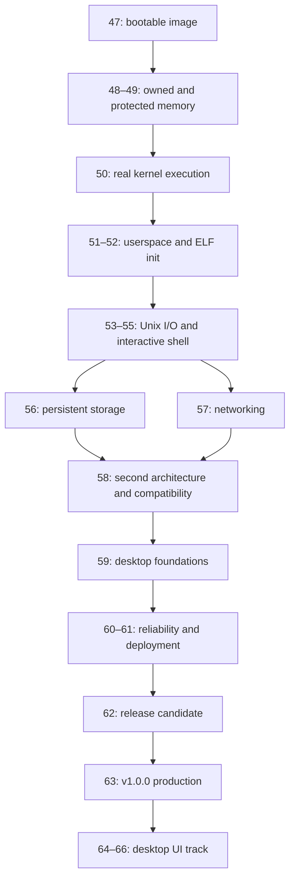

# KERNUL Roadmap

Status: Pre-Alpha. Planning revision: `v0.0.27` (2026-10-21).
Implemented checkpoint: Task 47.5, recorded in `v0.0.32`.
Next implementation task: **48.1 — Validated usable/reserved region ownership**.

This is the active phase plan. Phases 0–46 retain their historical identities;
their completed contracts do not establish bootability or application support.
Phase 47's boot gate is complete: Tasks 47.1–47.5 are verified on the selected
x86_64 UEFI q35 target. Phases 48 and later are planned, not implemented.
Versions are exit gates, not calendar promises or percentages of completion.

## Release direction

`v1.0.0` targets a production kernel and command-line system on an explicit
x86_64 and AArch64 support matrix. Bring up x86_64 first; AArch64 must pass the
same functional gates before it is included in the production release.

A full desktop UI follows the initial production release. Its foundations are
required before `v1.0.0`: process isolation, virtual-memory mappings, shared
buffers, local IPC, blocking event notification, clocks, controlled display
access, and keyboard/pointer events. Section “Desktop groundwork” defines the
functional proof; a boot logo alone does not satisfy it.

Initial reference targets are QEMU x86_64 `q35` and AArch64 `virt`, with pinned
machine/CPU, firmware, bootloader, and device configurations. Production support
applies only to configurations actually validated. Include a physical machine
only after selecting its concrete devices and passing the same workload;
neither architecture support nor UEFI implies support for every vendor board.

The `v1.0.0` workload includes:

- Boot into a real userspace init and an interactive shell.
- Run a pinned Linux-ABI userland build, including the documented Z shell goal,
  with executable loading, arguments/environment, pipelines, redirection,
  signals, job control, and process cleanup.
- Read and write persistent files, retain committed data across reboot, and
  report storage failures without claiming writes succeeded.
- Complete a documented wired-network client/server workload, with blocking
  I/O, timeouts, peer shutdown, and error propagation.
- Keep an unprivileged faulty process from accessing kernel memory, another
  process's private memory, or unauthorized device mappings.
- Run the small userspace display/input proof defined below.
- Install or deploy an image, diagnose a failure, and recover a known working
  image using documented procedures.

Select exact userland builds, devices, resource limits, and workload budgets
while implementing the relevant milestone; freeze them before release
candidates. A documented syscall subset is the compatibility claim. Universal
Linux/POSIX compatibility, a desktop environment, vendor GPU acceleration,
Wi-Fi, broad hardware coverage, and SMP are outside the initial release scope.
SMP or additional interfaces become required only if the selected production
workload demonstrates that the bounded initial target cannot meet its needs.

## Criticality and alignment with existing phases

| Priority | Work | Evidence in the current tree | Alignment / disposition |
| :--- | :--- | :--- | :--- |
| P0 — boot gate met | Executable, architecture entry, boot handoff, diagnostics | The selected UEFI q35 image reaches `kernel_main()`, PMM stub initialization, and `arch_halt()`; invalid Limine handoff is diagnosed before common entry | Phase 47 complete; preserve this boot path while implementing its dependent runtime surfaces |
| P0 — corruption blocker | Physical ownership/reclaim, allocation, page permissions, faults | `mm_phys_init()` ignores `mem_start`; its kernel-end bump can lie outside the selected usable region. Free is a no-op; `address_space_alloc()` always returns NULL | Task 48.1 must establish physical ownership before page allocation; Phases 48–49 complete allocation/mappings |
| P0 — execution blocker | Real CPU switching, interrupts, user entry, syscalls | Hardware CPU-state headers are placeholders; `sched_yield()` changes bookkeeping without switching; `sys_dispatch()` always returns `KERN_ENOSYS` | Complete Phase 4/5 runtime work in Phases 50–52, then safe asynchronous execution in Phase 54 |
| P0 — process blocker | Process allocation, ELF load, execution, exit/reap | `process_alloc()` always returns NULL; `elf_image_validate()` marks images unsupported; `init_launch()` cannot launch a process | Phase 52 owns the explicit extension of the old init stop boundary |
| P1 — required for v1.0 | Unix I/O, shell, persistent storage, networking | VFS operations return `KERN_ENOSYS`; Phase 6 contracts and Phase 7 surfaces exist without a working shell | Phases 53–57 close the original Unix/shell/compatibility goals |
| P1 — required for v1.0 | Both architecture targets, desktop foundations, bounded compatibility | AArch64 has no working entry/vector implementation; display/input/IPC runtime paths are absent | Phases 58–59; reuse working memory, I/O, and process mechanisms |
| P1 — required for v1.0 | Isolation, resource cleanup, deployment, support evidence | Hosted tests and object compilation currently provide no guest workload or deployable-image evidence | Functional failures are handled throughout; Phases 60–63 qualify the release |
| P2 — preserve, do not expand for its own sake | Session recovery/retry and governance metadata | Phases 15–46 provide frozen lifecycle facts, diagnostics, and metadata checks | Keep the contracts stable. Additional manifests, mirrors, and label checks are not the next task |
| Post-v1.0 | Compositor, desktop session, window management, GUI applications | No desktop stack exists | Build above the required desktop groundwork after the kernel/CLI release |

P0 precedes dependent work. P1 is mandatory for the declared release, even when
it is not the next dependency. P2 remains maintenance work unless a concrete
functional defect requires it. A higher phase number does not raise priority.

## Architectural hierarchy at the critical boundaries

The High/Mid/Low hierarchy remains a code-structure rule, not a substitute for
functional completion. Implement it while changing the owning boundary; avoid
an unrelated repository-wide refactor.

| Boundary / owning phase | High: orchestration | Mid: decisions | Low: implementation |
| :--- | :--- | :--- | :--- |
| Boot / 47–49 | Sequence bootstrap and its stop policy | Validate handoff, choose usable resources, enforce initialization prerequisites | Entry ABI, linker placement, map decoding, UART/MMIO, page-table operations |
| Execution / 50–52 | Sequence scheduler bootstrap and process launch | Determine runnable state, validate image/ownership, translate launch failures | Register save/restore, object/page allocation, byte parsing, mappings, privilege transitions |
| I/O / 53–57 | Sequence a requested operation and its completion policy | Resolve descriptors, validate rights, apply EOF/error/blocking rules | Buffer copies, device transfers, queue operations, filesystem encoding |
| Desktop groundwork / 59 | Sequence authorized display/input operations | Validate buffer ownership, access rights, and event lifetime | Framebuffer mapping, pixel layout, input reports, device notification |

Existing abstraction debt is assigned to the work that needs it:

- Task 47.1 resolved `kernel_main()` abstraction mixing: orchestration now
  calls domain steps, with memory selection and primitive operations below it.
  The entry's validation/PMM/halt behavior is preserved.
- [High] `init_launch()` in `core/init.c:17` mixes launch sequencing, member
  assignment, cleanup, and status handling at lines 23–48. Phase 52 must keep
  composition and ownership decisions above allocation/mapping mechanisms.
- [High] `idle_init()` in `sched/idle.c:74` mixes thread bootstrap with byte
  clearing and character-by-character label construction at lines 83–99.
  Phase 50 must separate initialization decisions from storage operations.

The remaining items are implementation obligations, not completed fixes.
Keep the step-down ordering, layer call rules, named constants, and function
size limits from `AGENTS.md` at each changed boundary. Do not add layers that
hide allocation, locks, interrupt state, or ownership cost.

## Milestones to production

| Version goal | Planned phases | Exit gate |
| :--- | :--- | :--- |
| `v0.1.0` | 47 | Boot gate met at Task 47.5 (`v0.0.32` implementation checkpoint): a real x86_64 kernel image boots through a documented handoff and produces guest-owned serial diagnostics |
| `v0.2.0` | 48–49 | Reserved memory stays protected; frames and mappings are reclaimable; access permissions and faults work |
| `v0.3.0` | 50 | Real kernel threads switch stacks/registers; bootstrap establishes current only through a switch |
| `v0.4.0` | 51–52 | A userspace program executes syscalls; a real ELF init launches, exits, and is reaped |
| `v0.5.0` | 53–55 | Interactive command execution, pipes, redirection, foreground/background jobs, and signals work |
| `v0.6.0` | 56 | Persistent storage survives reboot and obeys its documented flush/recovery semantics |
| `v0.7.0` | 57 | The selected network workload succeeds and handles disconnects/timeouts correctly |
| `v0.8.0` | 58–59 | The declared workload works on both reference architectures; authorized display/input and shared-buffer proofs work |
| `v0.9.0` | 60–61 | Workload/resource budgets, isolation, failure cleanup, deployment, and recovery are qualified |
| `v1.0.0-rc.N` | 62 | Support matrix and ABI subset are frozen; the exact distributable images pass the acceptance workload |
| `v1.0.0` | 63 | The qualifying candidate is published with reproducible inputs, integrity evidence, documentation, and a support policy |

Each numbered phase below is planned and has ordered, single-surface tasks.
Finish a dependency before starting the task that consumes it; independent
storage/network tasks may proceed once their actual I/O prerequisites exist.

## Phase 47 — Bootable architecture target (`v0.1.0`)

Priority: P0. Status: Complete on the selected x86_64 UEFI q35 target; Tasks 47.1–47.5 verified. Depends on the existing boot contract only.

| Task | One surface | Completion evidence |
| :--- | :--- | :--- |
| **47.1 — complete** | Freestanding x86_64 executable linkage | A real ELF executable links bootstrap code, including `init/main.c`, against architecture-owned implementations; no stub architecture or unresolved hosted symbols. Verify the image format, entry symbol, and load segments once. This task does not claim the image boots |
| **47.2 — complete** | Architecture boot entry | Choose and pin one existing bootloader/handoff protocol; establish the stack, C-entry state, and exception stop behavior. Keep the instruction/ABI work in `arch/` |
| **47.3 — complete** | Boot-info handoff adapter | Populate validated memory regions and kernel reservations with an explicit lifetime; consume firmware/device-tree data only as required by the selected target |
| **47.4 — complete** | Early diagnostic output | The guest emits a known boot marker and a meaningful fatal-stop reason through its own serial backend |
| **47.5 — complete** | Guest bootstrap composition | The chosen QEMU image reaches `kernel_main()` and its documented stop; invalid handoff takes a diagnosed terminal path |

Task 47.2 uses Limine 12.9.3 with a pinned protocol header and base revision 6.
The x86_64 image now links in the higher half and enters through `_start`.
UEFI q35 execution verifies the owned stack/GDT/IDT and accepted base revision;
a direct invalid-instruction fault verifies terminal exception dispatch.
Task 47.3 copies Limine's memory map into image-owned `boot_info_t` storage,
using the executable-address response and page-aligned linker bounds for the
kernel extent. The image reservation includes the stack, descriptor tables,
and copied handoff. Only explicitly usable RAM stays usable; bootloader,
firmware, and device memory remain reserved without reclaiming anything.
The existing 32-region limit is retained. Overflow, unaligned usable ranges,
and overlaps after outward reservation rounding are rejected rather than
normalized. The reference UEFI q35 guest supplies 32 entries and passes this
adapter. Focused hosted checks cover reservation/lifetime preservation and
the bounds/overlap failure paths. Task 47.5 now transfers the validated handoff
to the existing common bootstrap.

Task 47.4 adds the q35 COM1 backend at port `0x3f8`, 115200 baud, 8N1.
Guest-owned output identifies C entry, the validated handoff, unsupported
protocol, invalid handoff, and terminal early CPU exceptions. Transmission and
the final UART drain use bounded polling; output is best effort, with no timer,
IRQ driver, allocation, firmware service, or general console/input API.
`make run` exposes COM1 on the host terminal. Real UEFI q35 checks verify the
normal markers, a missing-response fatal path, and a direct invalid-instruction
exception diagnostic followed by `arch_halt()`. Exception output is generic;
vector/register dumps and runtime console behavior remain outside this task.

Task 47.5 returns the immutable image-owned handoff from architecture setup;
`_start` passes it to `kernel_main()` using the x86_64 calling convention.
Common validation, largest-usable-range selection, PMM initialization, and
terminal halt keep their existing order and public contracts. Guest checks
observe the actual common entry, aligned stack, disabled interrupts, PMM
arguments, and final CPU halt. A missing Limine response emits the fatal reason
without reaching common entry or changing PMM state. The hosted bootstrap
contract check also passes. No page allocation, scheduler/current-thread state,
context switch, or userspace launch is activated.

The PMM remains a stub: its bump pointer starts at the kernel's end and ignores
the selected range's start. In the reference guest, the kernel is above the
largest usable region, leaving this stub exhausted. This boot-only checkpoint
does not establish physical allocation correctness; Task 48.1 must correct the
ownership handoff before allocation is used.

Keep the hosted stub target available for the existing contracts. Add the real
executable target separately. Do not involve scheduler, VFS, networking, or
session lifecycle metadata in Task 47.1. Cross-toolchain and bootloader
versions are selected for this concrete build, not through a separate registry
or speculative platform abstraction.

## Phase 48 — Physical ownership and allocation (`v0.2.0`)

Priority: P0. Depends on 47.

Next task: **48.1 — Validated usable/reserved region ownership**. The existing
PMM's kernel-end bump must not substitute for the selected usable range's
bounds. Establish valid ownership before enabling any page allocation.

Ordered surfaces: (1) validated usable/reserved region ownership; (2) physical
frame allocation/reclaim; (3) the minimal object allocator required by processes
and address spaces. Protect kernel, stack, handoff, firmware, and device memory;
reject malformed/overflowing ranges and allocator exhaustion deterministically.

Gate: allocate, use, free, and reuse real frames without returning reserved
memory or silently leaking it. Exercise the failure and reservation cases that
can corrupt the guest. Preserve the PMM public boundary while replacing its
bump/no-op implementation.

## Phase 49 — Virtual memory and faults (`v0.2.0`)

Priority: P0. Depends on 48.

Ordered surfaces: (1) architecture page-table operations and required TLB/cache
ordering; (2) common mapping ownership; (3) page-fault handling. Establish
kernel/user separation and execute/write protections before userspace runs.

Gate: a guest can map/use/unmap memory, reclaim its pages, and demonstrate
expected faults for forbidden access. Hardware formats and ordering stay in
`arch/`; common code owns mapping policy and lifetime. Reuse these mappings for
shared buffers later rather than designing a second graphics allocator.

## Phase 50 — Kernel execution (`v0.3.0`)

Priority: P0. Depends on 49.

Ordered surfaces: (1) real architecture atomics/order primitives; (2) execution
state initialization/save/restore, including required extended/TLS state;
(3) the scheduler bootstrap boundary; (4) cooperative run/wait/wake and idle
operation. Preserve lock/interrupt ownership explicitly at each switch.

Gate: two guest threads execute on distinct stacks and resume with preserved
state; the first current thread is established only by the first real context
switch. A hosted pointer update or a no-op switch is not completion evidence.
Begin with one CPU and bounded scheduling behavior; do not add SMP policy here.

## Phase 51 — User privilege and syscall boundary (`v0.4.0`)

Priority: P0. Depends on 50.

Ordered surfaces: (1) user entry/return state; (2) architecture syscall/trap
entry; (3) dispatch for the small program's real calls; (4) checked user-memory
transfer and process-local fault reporting. Define architecture-specific syscall
numbers, calling conventions, return/error values, and pointer rules in the ABI
strategy before relying on a userspace binary.

Gate: a real unprivileged diagnostic program completes a syscall round trip;
invalid user memory cannot crash or expose the kernel. This probe is an
execution check, not a claim of ELF/libc/Linux userland compatibility.

## Phase 52 — ELF processes and init (`v0.4.0`)

Priority: P0. Depends on 51.

Ordered surfaces: (1) process/address-space allocation and teardown; (2) an
executable-image input with explicit ownership; (3) ELF segment validation and
loading; (4) the initial stack/TLS/argument/environment ABI; (5) init launch;
(6) exit and wait/reap. Introduce only the process/clone behavior required by the
chosen userland; release every resource on partial launch failure.

Gate: a real static ELF init runs, launches a child, observes its status, and
reclaims resources on exit. Reject invalid segment bounds and permissions.

This phase explicitly extends the Phase 5 composition boundary. Update
`ARCHITECTURE.md` section 6.1, `REPOSITORY_RULES.md`, the init contract, and its
relevant tests when successful launch replaces the old `KERN_ENOSYS` stop.
Retain one canonical launch path; this plan itself does not change that API.

## Phase 53 — File and device I/O (`v0.5.0`)

Priority: P1. Depends on 52.

Ordered surfaces: (1) descriptor lifetime/inheritance/duplication; (2) VFS
path/open/read/write/close behavior; (3) an initial memory-backed root and
console/device endpoints; (4) pipes, EOF, blocking/wakeup, and nonblocking
readiness. Enforce credentials/permissions at the owning boundary.

Gate: guest processes perform real file I/O and transfer data through a pipe;
closing the last writer produces EOF; invalid descriptors fail safely. Expose
readiness through ordinary descriptors so future input, network, and desktop
clients can use the same I/O model.

## Phase 54 — Interrupt-driven runtime (`v0.5.0`)

Priority: P1. Depends on 50–53.

Ordered surfaces: (1) architecture interrupt/timer delivery; (2) monotonic time
and sleep; (3) preemption with explicit kernel critical sections; (4) wakeups
and signal interaction; (5) blocking readiness notification for implemented
endpoints. IRQ-safe locking and hardware ordering are functional requirements.

Gate: a CPU-bound user process cannot starve another runnable process; sleepers
and blocked readers resume correctly without lost wakeups or busy polling.
Clock and readiness semantics must serve later event loops unchanged in intent.

## Phase 55 — Interactive shell (`v0.5.0`)

Priority: P1. Depends on 52–54.

Ordered surfaces: (1) terminal/PTY behavior; (2) controlling-terminal and process
group integration; (3) signal/job-control behavior; (4) the real shell workload.
Use a selected existing userland build rather than creating a new shell.

Gate: command execution, redirection, pipelines, exit/wait, foreground/background
jobs, interrupt, and terminal recovery work in the guest. Trace missing syscalls
from the chosen build and implement those dependencies. Z shell remains the
ABI strategy's target; its pinned build must pass by Phase 58 before a release
compatibility claim is made.

## Phase 56 — Persistent storage (`v0.6.0`)

Priority: P1. Depends on the memory and asynchronous I/O surfaces above.

Ordered surfaces: (1) one selected block backend/transport; (2) block completion,
error, and flush semantics; (3) one writable filesystem; (4) mount/root lifetime.
Use the driver's actual DMA/cache/ordering requirements; do not assume firmware
storage services remain available after boot.

Gate: the chosen guest workload writes, flushes, reboots, and reads back its
data. Interrupted writes and I/O errors obey documented recovery semantics;
reject unsupported/corrupt media without reporting false success. Filesystem
breadth and extra drivers wait for a concrete compatibility need.

## Phase 57 — Wired networking (`v0.7.0`)

Priority: P1. Depends on the memory and asynchronous I/O surfaces above.

Ordered surfaces: (1) one selected network backend/transport; (2) the bounded
packet/protocol path; (3) socket lifetime and blocking/error semantics; (4) the
selected userspace network workload. Specify the supported address/protocol
family and userland dependencies before claiming connectivity.

Gate: the guest exchanges data with a peer, times out unreachable operations,
and handles close/reset without leaks or deadlock. Packet-length, buffer-
ownership, and error cases belong to this working path; unrelated protocol
coverage, wireless devices, and speculative throughput tuning do not.

## Phase 58 — Portability and bounded compatibility (`v0.8.0`)

Priority: P1. Depends on 47–57.

Ordered surfaces: port each real architecture boundary to AArch64, starting
with boot/vectors and proceeding through memory, switching, interrupts/syscalls,
and selected device transports. Each task changes one owning surface. Keep
shared policy common without assuming x86 ordering or register layout.

Gate: the same pinned CLI/storage/network workload passes on both declared
reference configurations. Record their bootloader/firmware, machine/CPU,
devices, libc/shell build, supported syscalls, and exclusions. Select physical
machines here if bare-metal production support will be claimed. A compile-only
AArch64 target or one architecture silently labeled experimental does not meet
the stated two-architecture `v1.0.0` goal.

## Phase 59 — Desktop groundwork (`v0.8.0`)

Priority: P1. Depends on 49, 51–54, and the architecture port it exercises.

Implement the ordered single-surface tasks in the next section. Gate: an
authorized userspace client draws through a bounded display mapping, exchanges
a shared buffer with another process, and receives keyboard/pointer events
through a blocking event loop on both reference architectures. A fault or exit
releases its mappings and handles without wedging the shell or kernel.

## Desktop groundwork

| Task | Owning surface | Required behavior / proof | Later consumer |
| :--- | :--- | :--- | :--- |
| 59.1 | Shared-memory object/mapping lifetime | Two unprivileged processes share an explicitly authorized buffer; private mappings stay private; closing/exiting cannot expose stale pages | Compositor/client image buffers |
| 59.2 | Local IPC endpoint | Messages and peer closure have bounded lifetime, readiness, backpressure, and ownership; use the existing descriptor/event model | Desktop client/service communication |
| 59.3 | Display-buffer ownership | Validate dimensions, stride, format, mapped length, and access rights; reserve the actual physical/device buffer; map only authorized regions | A userspace display service |
| 59.4 | Concrete keyboard/pointer input | Deliver typed events with monotonic timestamps and explicit overflow behavior from a selected backend | Focus/input routing in userspace |
| 59.5 | Desktop foundation composition | A small userspace probe draws, receives input while blocking, and cleans up shared buffers/handles on exit | Evidence that a later desktop can be built |

Boot handoff additions are introduced only when 59.3 actually requires them;
`boot_info` already permits concrete task-driven extensions. If firmware gives
a CPU-accessible linear framebuffer, preserve its geometry/format/ownership
before boot services end. Do not depend on firmware BLT/console/input calls as
the runtime display stack. A target lacking a usable linear framebuffer needs
one concrete display backend; unsupported pixel modes must fail explicitly.

AArch64 `virt` has no default display device: select and pin a working one in
the support matrix, and discover device placement from the handoff/device tree.
Do not copy x86 device addresses into shared code. These constraints follow the
[UEFI graphics contract](https://uefi.org/specs/UEFI/2.10/12_Protocols_Console_Support.html#graphics-output-protocol)
and [QEMU virt platform documentation](https://www.qemu.org/docs/master/system/arm/virt.html).

Mapping and blocking notification should follow the established behavioral
models for [shared mappings](https://pubs.opengroup.org/onlinepubs/9799919799/functions/mmap.html)
and [descriptor readiness](https://pubs.opengroup.org/onlinepubs/9799919799/functions/poll.html),
with Kernul's supported subset documented explicitly.

Rendering, fonts, window policy, focus routing, clipboard, application UI, and
compositor/client protocols belong in userspace. Do not add widgets or a GUI
framework to the kernel, or freeze a desktop protocol before a real client and
service use it. GPU acceleration, full modesetting, audio, and additional input
backends follow demonstrated desktop needs; they do not block these foundations.

## Phase 60 — Reliability and isolation qualification (`v0.9.0`)

Priority: P1. Depends on the working workload from 58–59.

Qualify each functional boundary separately: process faults, malformed
executables, resource exhaustion, launch/exit cleanup, descriptor and mapping
lifetime, storage interruption, and network peer failure. Exercise realistic
compositions to detect leaks, lost wakeups, and privilege crossings. Check
userspace/kernel and device access permissions against actual operations.

Gate: the declared workload meets documented time/memory/resource budgets over
a defined sustained run, with no unexplained resource growth, corruption,
starvation, or kernel crashes. Set durations, resource ceilings, and response
budgets from measured workload needs before candidate freeze; arbitrary test
counts and coverage percentages are not release criteria.

## Phase 61 — Deployment and recovery (`v0.9.0`)

Priority: P1. Depends on 56 and the supported target matrix.

Ordered surfaces: (1) versioned boot/root image packaging; (2) installation or
VM deployment; (3) update/rollback and offline recovery; (4) actionable failure
logs and operator documentation. Record exact source/toolchain/dependency inputs,
license obligations, artifact checksums/signatures, and supported configuration.

Gate: an operator can deploy, boot, update, and recover a known working image
using the documented path. Failed installation/update must not silently destroy
the only working system. This is deployment recovery; it does not extend the
frozen session recovery/retry APIs or introduce automatic retry policy.

## Phase 62 — Release candidates (`v1.0.0-rc.N`)

Priority: P1. Depends on 60–61.

Freeze the supported ABI/syscall subset, image format, target matrix, workload,
resource budgets, and documented limitations. Run the acceptance workload on
the exact distributable candidate images for both architectures. Permit fixes
for release-blocking defects; route new features to the later track.

Gate: no unresolved boot, execution, isolation, data-loss, or workload-blocking
defects on supported configurations; all claimed behaviors have direct evidence.
Record artifact/source identity and candidate results together. A new build or
relevant fix re-runs affected acceptance paths before promotion.

## Phase 63 — Production release (`v1.0.0`)

Priority: P1. Depends on an accepted Phase 62 candidate.

Publish the qualifying images, source/build inputs, integrity evidence, support
matrix, ABI/compatibility statement, installation/recovery documentation, known
limits, and security/bug-reporting/support policy. Promote the tested artifacts;
an unverified rebuild is not the same release candidate.

Gate: a user following the published instructions can reproduce the supported
workload and recover from a failed deployment. Both architecture targets meet
the declared scope. “Production” refers to that documented operating envelope,
not to untested hardware or a future desktop experience.

## Desktop UI after the initial production release

These are subsequent feature goals, not prerequisites for the initial CLI
release. Reconfirm their concrete task contracts before implementation.

| Planned phase | Visible goal | Prerequisites / boundary |
| :--- | :--- | :--- |
| 64 | Userspace software compositor with a real client | Phase 59 mappings/IPC/input; compose submitted buffers and present frames |
| 65 | Window and desktop-session behavior | Input focus, window lifetime, terminal application, session startup/shutdown, client failure isolation |
| 66 | A usable desktop workload | Chosen toolkit/applications, fonts/text, accessibility and interaction requirements, packaging; add acceleration or new drivers only when this workload needs them |

Later version numbers and additional platforms follow observed feature scope;
this plan does not promise a desktop ship date or preselect a display protocol.
Preserve the stable `v1.0.0` kernel ABI while evolving versioned userspace protocols.

## Verification budget

Every added check must identify (1) an implemented behavior; (2) the failure it
can catch; and (3) the release or functionality gate that failure would block.
If those cannot be named, do not add the check. Prefer one representative
end-to-end workload plus focused checks at corruption/isolation boundaries.

| Change | Required evidence | Avoid |
| :--- | :--- | :--- |
| Documentation/roadmap only | Review factual references, plan dependencies, and diff integrity | Recompiling or rerunning the unchanged kernel suite |
| One runtime surface | Compile/link the affected target; verify its real behavior and material failure path | Tests of placeholder behavior, mirrored implementation, or future features |
| Boot or architecture code | Boot the affected guest and observe the changed boundary | Treating successful hosted linking as guest execution |
| Memory, user access, ELF, storage, packet handling | Focused bounds/ownership/failure cases against the implemented path | Broad unrelated fuzz campaigns or invented unsupported inputs |
| Broad runtime integration / candidate image | The declared guest workload on affected supported targets; full relevant regression coverage before release | Repeating unchanged suites or substituting a test-count target for working software |

Retain existing useful contract/freeze checks while their contracts exist. Add
or change a compile-time assertion only when it protects a boundary being
changed. Keep one governance consistency check; do not grow more metadata
surfaces, literal-label tests, or synthetic mutation matrices as milestones.
Run comparative performance work only when a real workload misses its budget.

## Phase and implementation discipline

- One task changes one owning surface, with its supporting implementation,
  contract documentation, and necessary functional evidence.
- Define the required shape and implement the minimum real behavior for that
  task. Keep failure/ownership/locking/ordering visible.
- High-level code calls Mid only; Mid calls Low wrappers only. Order callers
  above callees and keep raw library/hardware/primitive operations below policy.
- A phase is complete only when its stated functional exit gate is met.
  Contracts and hosted stubs count only toward their historical contract gates.
- Historical “no MMU/no interrupts/no execution” limits describe those phases;
  a new named runtime phase authorizes only its explicit behavior. They are not
  permanent prohibitions on the operating system.
- Existing public behavior changes require the owning contract and affected
  documentation/tests to change together. Phase 52's init extension is explicit;
  no duplicate bootstrap/launch path is permitted.
- Keep hardware truth in architecture/device code. Reuse existing boundaries
  before introducing new common abstractions.
- No speculative fields, helpers, compatibility claims, optimization, or future
  phase implementation. The stop condition remains buildable, deterministic,
  testable for actual behavior, and reviewable.

## Historical phase ledger

The following records implemented contracts and diagnostics, not production
feature completion. It preserves phase identities while moving active runtime
work onto the dependency path above.

| Historical phase | Implemented checkpoint | Remaining functional dependency |
| :--- | :--- | :--- |
| 0 | Foundation documents, boot contract, entry validation | Real linkage/boot: 47 |
| 1 | Architecture halt/early-init boundaries and CPU-state placeholders | Hardware entry/exception state: 47; switching: 50/58 |
| 2 | Memory-map/ordering vocabulary and PMM stub | Allocation/reclaim/protected mappings: 48–49 |
| 3 | Primitive types, errors, assertions, lists, hosted spinlocks | Real architecture atomics and interrupt discipline: 50/54/58 |
| 4 | Threads, run queue, scheduler, context/idle contracts | Real execution/bootstrap: 50 |
| 5 | Process/address-space/ELF/init contracts | User execution and successful init: 51–52 |
| 6 | FD/VFS/pipe/signal/session/terminal structures | Working Unix semantics: 53–55 |
| 7 | Interactive console/activation/readiness/admission/dispatch/operand surfaces | Original shell completion rule remains unmet: 55/58 |
| 8 | Execution-transfer and selection boundaries | Actual switching: 50; original compatibility forecast superseded |
| 9 | Scheduler state, runnable container, container selection | Runtime scheduler integration: 50/54 |
| 10 | Handoff, operand view, explicit initiation gate | Runtime transfer: 50–52 |
| 11 | Execution outcome record/view/aggregation | Retain stable; wire only for a concrete runtime requirement |
| 12 | Failure/completion acknowledgment gates | Retain stable |
| 13 | Acknowledgment-driven initiation gating | Retain stable |
| 14 | Terminal state/cause publication | Retain stable |
| 15 | Session finalization publication | Frozen lifecycle boundary |
| 16 | Resource ownership declaration | Frozen lifecycle boundary |
| 17 | Explicit local reclamation | Frozen lifecycle boundary |
| 18 | Recovery eligibility | Frozen lifecycle boundary |
| 19 | Single-use recovery authorization | Frozen lifecycle boundary |
| 20 | Single-attempt recovery execution | Frozen lifecycle boundary |
| 21 | Immutable recovery outcome recording and readiness hardening | Frozen lifecycle boundary |
| 22 | Read-only recovery outcome observation | Frozen lifecycle boundary |
| 23 | Declarative retry policy | Frozen lifecycle boundary |
| 24 | Single-use retry authorization | Frozen lifecycle boundary |
| 25 | Historical freeze through retry authorization | Superseded explicitly by 26–30 |
| 26 | Single-attempt retry execution | Frozen lifecycle boundary |
| 27 | Final retry execution-result publication | Frozen lifecycle boundary |
| 28 | Retry outcome recording | Frozen lifecycle boundary |
| 29 | Read-only retry outcome observation | Frozen lifecycle boundary |
| 30 | Retry lifecycle freeze/consolidation | Frozen lifecycle boundary |
| 31 | Read-only lifecycle introspection | Diagnostic maintenance |
| 32 | Passive invariant verification | Diagnostic maintenance |
| 33 | Read-only lifecycle provenance | Diagnostic maintenance |
| 34 | Diagnostic boundary assertion | Diagnostic maintenance |
| 35 | Compile-time freeze enforcement | Contract maintenance |
| 36 | Documentation synthesis | Metadata maintenance |
| 37 | Snapshot-scoped audit | Diagnostic maintenance |
| 38 | Export serialization | Metadata maintenance |
| 39 | Inert extension declaration | Metadata maintenance |
| 40 | Governance consolidation | Metadata maintenance |
| 41 | Governance index | Metadata maintenance |
| 42 | Governance provenance | Metadata maintenance |
| 43 | Governance compatibility | Metadata maintenance |
| 44 | Governance schema | Metadata maintenance |
| 45 | Governance manifest | Metadata maintenance |
| 46 | Hosted cross-table governance consistency | Check complete; no guest execution added |

Earlier maps may use a separate numbering scheme. The canonical phase numbers
here take precedence for new work. A lifecycle-only audit map does not replace
the runtime delivery plan.

## Frozen session lifecycle boundary

The production/runtime plan does not reinterpret the session lifecycle. The
following existing freeze rules are preserved:

Lifecycle stopping points (frozen):

- Recovery lifecycle is complete through outcome observation.
- Retry lifecycle is complete through outcome observation.
- No additional lifecycle behavior may be introduced without a new phase.
- Existing semantics must not be reinterpreted or extended.

Semantic freeze invariants:

Recovery:
- Recovery execution is single-attempt.
- Recovery outcome is immutable once published.
- Outcome observation is read-only and readiness-gated.

Retry:
- Retry lifecycle consists of exactly:
  1) retry execution;
  2) retry execution result publication;
  3) retry outcome recording;
  4) retry outcome observation.
- Observation is passive and read-only.
- Retry policy remains declarative meaning only.
- Retry authorization remains single-use authority only.
- No retry scheduling exists.
- No retry coordination exists.
- No retry escalation exists.
- No retry loops exist.
- No retry policy automation exists.
- No retry outcome reaction exists.
- Observation does not imply handling.
- Outcome existence does not imply action.

Authority freeze invariants:

- Authorization surfaces grant capability only.
- Authorization surfaces do not execute behavior.
- Authorization surfaces do not schedule work.
- Authorization surfaces do not coordinate subsystems.

Dependency freeze invariants:

No recovery or retry component may newly depend on:
- scheduler subsystems
- retry execution logic
- coordination or signaling systems
- time-based backoff or timers

Any such dependency requires a new phase.

Storage helper freeze invariants:

All storage helpers in the recovery/retry subsystem must remain:
- mechanical only
- load/store/CAS with explicit ordering
- non-semantic
- non-coordinating

Helpers must not grow:
- policy inference
- readiness checks
- derived-state logic
- convenience APIs

Observation freeze invariants:

All observation APIs must remain:
- readiness-gated
- acquire-ordered
- side-effect free
- non-allocating
- non-mutating

Observation must never:
- trigger behavior
- grant authority
- schedule work

Known forecast supersessions:

- Forecast Phase 19 retry action was superseded by retry authorization.
- Forecast Phase 20 scheduler observation was superseded by recovery execution.
- No documentation may describe retry scheduling, coordination, escalation,
  loops, policy automation, or outcome reaction as existing.
